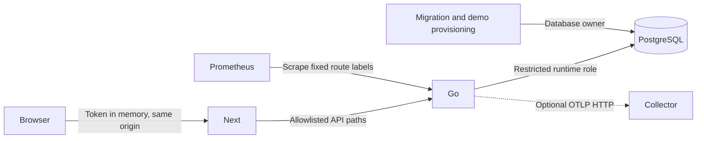

# Architecture and accounting model

## Journal representation

A workspace has currency-specific accounts. Each account starts at zero. Each posting contains 2–100 distinct account lines in one currency. A debit is represented by a negative movement and a credit by a positive movement in this ledger's signed convention. The sum must be zero. The account balance is the signed sum of its lines. The Funding control account permits a negative balance and offsets synthetic opening funds. The model does not assign account categories or normal-balance rules from a general ledger chart of accounts.

Amounts are stored as PostgreSQL `bigint`. The permitted line magnitude is (9 × 10¹⁵) minor units. Database aggregation uses `numeric` where sums can exceed a single line's range. USD, EUR, and IDR use two minor-unit digits. Conversions and multi-currency journals require a separate design. Client-visible amounts and sequences use decimal strings so JavaScript cannot round them.

Posting inserts and seals lines in a single transaction. The runtime role can call the posting function and cannot directly insert, modify, or remove journal rows. Database triggers protect posted history even from accidental owner updates, and composite foreign keys join entries to accounts and journals in the same workspace and currency. The database validates balanced totals, exact reversal lines and non-overdraft projections. An application or database error aborts the entire transaction.

A reversal is a new journal linked to the original. It negates every line, remains subject to overdraft rules, and can be applied once per original. Reverse a correction with a new normal compensating journal if business policy calls for that.

## ADR 001 · PostgreSQL transaction and lock ordering

Use `READ COMMITTED` for posting. Take a transaction advisory lock on the workspace and idempotency key before reading any prior receipt. The next statement sees a concurrent commit after the lock becomes available. Serialize competing reversals on the original journal ID after checking for a replay. Sort and lock all affected account rows by UUID before writing entries. The posting function then takes a short workspace sealing lock before assigning the journal sequence. This preserves stable visible journal prefixes within a workspace even when disjoint-account postings execute concurrently. Sequence gaps are expected. Global sequence numbers do not establish a cross-workspace commit history. The per-workspace seal limits peak throughput for a single workspace.

Hash collisions between advisory keys may serialize unrelated operations. Unusual maintenance lock patterns can still cause PostgreSQL deadlocks. The engine retries known rollback errors up to three attempts total with short delays. Waits are bounded by lock, statement, and request timeouts. An ambiguous commit or network error is returned to the caller for retry using the same key. Durable idempotency has the same lifetime as the journal.

## ADR 002 · Historical inspection and statements

Current balances use the projection updated atomically during posting. Historical reads aggregate the journal under a read-only snapshot through a published sequence in the workspace. Reconciliation first validates its upper bound against an already visible sequence. The published workspace prefix is immutable and stable across statements at `READ COMMITTED`. Reconciliation compares journal ID, currency and total positive amount to a synthetic statement and persists the report with its optional receipt in the same transaction. A workspace/key advisory lock serializes concurrent retries. The report distinguishes missing, duplicate, unexpected, and mismatched lines. A duplicate may also contain mismatches. This demonstration uses journal IDs as shared correlation identifiers and does not perform fuzzy matching or account-level statement matching.

## ADR 003 · Deployment and operational boundaries

Use one API, one dashboard and one database. Versions of the schema are embedded with checksums and applied via a migration owner. Workspace checks run in both application authorization and database row policies. A transaction-local setting carries trusted application scope and prevents scope reuse through a pooled connection. The dashboard and operator use the same public API interface.
